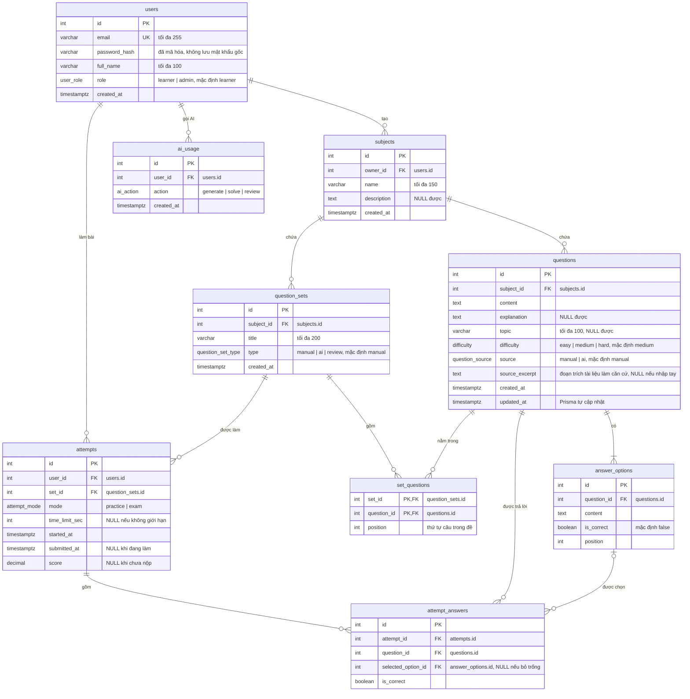

# Thiết kế cơ sở dữ liệu

File này giải thích thiết kế CSDL: có những bảng nào, vì sao thiết kế như vậy, ràng buộc nào cần giữ. Định nghĩa chạy thật nằm ở [`backend/prisma/schema.prisma`](../backend/prisma/schema.prisma).

**Hai file phải luôn khớp nhau.** Đổi bảng, cột, ràng buộc hay quy tắc xóa thì sửa cả `schema.prisma` lẫn file này, kèm migration mới, trong **cùng một PR**. Cách tạo migration xem `README.md` mục 5.

Hệ quản trị: PostgreSQL 18. ORM: Prisma 7.

## Sơ đồ

Ký hiệu quan hệ: `||` đúng 1, `|o` 0 hoặc 1, `o{` 0 hoặc nhiều, `|{` 1 hoặc nhiều.

## Ý nghĩa từng bảng

Trong database dùng tên `snake_case`; trong code Prisma dùng tên model và field `camelCase` (ví dụ cột `password_hash` là field `passwordHash`).

| Bảng              | Model Prisma    | Mỗi dòng là                                                |
| ----------------- | --------------- | ---------------------------------------------------------- |
| `users`           | `User`          | Một tài khoản                                              |
| `subjects`        | `Subject`       | Một môn học do một người tạo                               |
| `questions`       | `Question`      | Một câu hỏi trong ngân hàng câu hỏi của môn                |
| `answer_options`  | `AnswerOption`  | Một lựa chọn (A, B, C...) của một câu hỏi                  |
| `question_sets`   | `QuestionSet`   | Một đề                                                     |
| `set_questions`   | `SetQuestion`   | "Câu X nằm trong đề Y ở vị trí Z"                          |
| `attempts`        | `Attempt`       | Một lần một người làm một đề                               |
| `attempt_answers` | `AttemptAnswer` | Một câu đã trả lời trong một lần làm bài                   |
| `ai_usage`        | `AiUsage`       | Một lần gọi AI thành công, dùng để giới hạn lượt theo ngày |

## Kiểu dữ liệu

### Quy ước chung

- `id`: số nguyên tự tăng (`SERIAL`).
- Thời gian: `timestamptz` (có múi giờ), độ chính xác mili giây, lưu theo UTC. `created_at` và `started_at` mặc định là thời điểm tạo dòng.
- Chuỗi có giới hạn dùng `varchar(n)`; chuỗi dài (nội dung câu hỏi, giải thích, đoạn trích) dùng `text`.
- `attempts.score`: `decimal(5,2)`, thang 10, 2 chữ số thập phân.

### Độ dài tối đa của cột chuỗi

| Cột                   | Kiểu           |
| --------------------- | -------------- |
| `users.email`         | `varchar(255)` |
| `users.password_hash` | `varchar(255)` |
| `users.full_name`     | `varchar(100)` |
| `subjects.name`       | `varchar(150)` |
| `question_sets.title` | `varchar(200)` |
| `questions.topic`     | `varchar(100)` |

Các cột chuỗi còn lại dùng `text`. Giới hạn độ dài khi nhận dữ liệu từ người dùng (ví dụ nội dung câu hỏi tối đa 5000 ký tự) do API kiểm tra, ghi ở `docs/api.md`.

### Enum

| Enum trong database | Enum trong Prisma | Giá trị                       | Dùng ở cột             | Mặc định          |
| ------------------- | ----------------- | ----------------------------- | ---------------------- | ----------------- |
| `user_role`         | `UserRole`        | `learner`, `admin`            | `users.role`           | `learner`         |
| `question_set_type` | `QuestionSetType` | `manual`, `ai`, `review`      | `question_sets.type`   | `manual`          |
| `difficulty`        | `Difficulty`      | `easy`, `medium`, `hard`      | `questions.difficulty` | `medium`          |
| `question_source`   | `QuestionSource`  | `manual`, `ai`                | `questions.source`     | `manual`          |
| `attempt_mode`      | `AttemptMode`     | `practice`, `exam`            | `attempts.mode`        | (bắt buộc truyền) |
| `ai_action`         | `AiAction`        | `generate`, `solve`, `review` | `ai_usage.action`      | (bắt buộc truyền) |

Thêm giá trị mới vào enum cần một migration mới.

## Quyết định thiết kế

1. **Câu hỏi thuộc môn, không thuộc đề.** Một câu nằm được trong nhiều đề qua bảng trung gian `set_questions`, nên sửa câu một lần là mọi đề cập nhật theo.
2. **Đáp án là bảng riêng**, để `attempt_answers` ghi được chính xác lựa chọn của người dùng.
3. **Lưu từng câu trả lời**, không chỉ lưu điểm, vì thống kê câu sai và đề ôn đều cần dữ liệu này.
4. **Không có bảng thống kê.** Câu hay sai được tính từ `attempt_answers` với `is_correct = false`, nên dữ liệu chỉ nằm một chỗ.
5. **Đề ôn từ câu sai** là một `question_sets` có `type = review`, trỏ lại các câu cũ qua `set_questions`.
6. **Giới hạn lượt AI** bằng cách đếm số dòng `ai_usage` của người dùng trong ngày.
7. **`attempt_answers.is_correct` được lưu lại lúc làm bài**, không tính lại từ đáp án hiện tại. Nhờ vậy sửa đáp án của câu hỏi sau này không làm thay đổi kết quả các bài đã làm.

## Quy tắc khi xóa

Mọi khóa ngoại dùng `ON DELETE CASCADE` (xóa dòng cha thì xóa luôn dòng con), trừ `attempt_answers.selected_option_id` dùng `ON DELETE SET NULL`.

| Khi xóa                       | Bị xóa theo                                                                                 | Bị đổi                                                                     |
| ----------------------------- | ------------------------------------------------------------------------------------------- | -------------------------------------------------------------------------- |
| Một tài khoản (`users`)       | Toàn bộ môn học, câu hỏi, đề, lượt làm bài, câu trả lời và `ai_usage` của người đó          |                                                                            |
| Một môn học (`subjects`)      | Câu hỏi, đáp án, đề của môn, các lượt làm đề đó và câu trả lời                              |                                                                            |
| Một đề (`question_sets`)      | Dòng `set_questions` của đề, **các lượt làm đề đó và câu trả lời**                          | Câu hỏi vẫn còn trong ngân hàng của môn                                    |
| Một câu hỏi (`questions`)     | Đáp án của câu, dòng `set_questions` chứa câu, **mọi câu trả lời cho câu đó trong lịch sử** |                                                                            |
| Một đáp án (`answer_options`) |                                                                                             | `attempt_answers.selected_option_id` thành `NULL`, `is_correct` giữ nguyên |
| Một lượt làm bài (`attempts`) | Các câu trả lời của lượt đó                                                                 |                                                                            |

Hệ quả cần nhớ khi viết code:

- **Xóa câu hỏi hoặc đề sẽ làm mất lịch sử làm bài liên quan**, nên thống kê câu sai cũng mất theo. Điểm (`attempts.score`) của các lượt đã nộp giữ nguyên nếu chỉ xóa câu hỏi. Frontend phải hỏi xác nhận và nói rõ điều này trước khi xóa.
- **Sửa đáp án bằng cách thay toàn bộ danh sách** (`PATCH /api/questions/:id` có gửi `options`) sẽ xóa các đáp án cũ. Các bài đã làm vẫn giữ đúng hay sai, nhưng không còn biết người dùng đã chọn đáp án nào (`selected_option_id` thành `NULL`).

## Chỉ mục (index)

| Bảng              | Chỉ mục                 | Phục vụ                             |
| ----------------- | ----------------------- | ----------------------------------- |
| `subjects`        | `owner_id`              | Danh sách môn của một người         |
| `question_sets`   | `subject_id`            | Danh sách đề của môn                |
| `questions`       | `subject_id`            | Ngân hàng câu hỏi của môn           |
| `answer_options`  | `question_id`           | Lấy đáp án của câu                  |
| `set_questions`   | `question_id`           | Tìm các đề chứa một câu             |
| `attempts`        | `(user_id, started_at)` | Lịch sử làm bài, sắp theo thời gian |
| `attempts`        | `set_id`                | Các lượt làm một đề                 |
| `attempt_answers` | `question_id`           | Thống kê câu hay sai                |
| `attempt_answers` | `selected_option_id`    | Đặt `NULL` nhanh khi xóa đáp án     |
| `ai_usage`        | `(user_id, created_at)` | Đếm lượt AI trong ngày              |

Khóa chính và các ràng buộc `UNIQUE` ở mục dưới cũng tự tạo chỉ mục.

## Ràng buộc

### Database tự đảm bảo

- `users.email` là duy nhất.
- Một câu không xuất hiện hai lần trong cùng một đề: khóa chính kép `(set_id, question_id)` của `set_questions`.
- Mỗi câu chỉ có một câu trả lời trong một lượt làm bài: `UNIQUE(attempt_id, question_id)` của `attempt_answers`. Người dùng đổi đáp án thì cập nhật dòng cũ, không thêm dòng mới.
- Mọi khóa ngoại phải trỏ tới dòng có thật, theo quy tắc xóa ở trên.

### Code phải tự kiểm tra

Database không kiểm tra được các điều sau, nên backend phải kiểm tra trước khi ghi:

- Mỗi câu hỏi có 2–6 đáp án và **đúng 1** đáp án đúng.
- `attempt_answers.question_id` phải thuộc đề của `attempts.set_id` tương ứng.
- `attempt_answers.selected_option_id`, nếu có, phải là đáp án của đúng `question_id` đó.
- `attempts.time_limit_sec` bắt buộc với `exam`, phải là `NULL` với `practice`.
