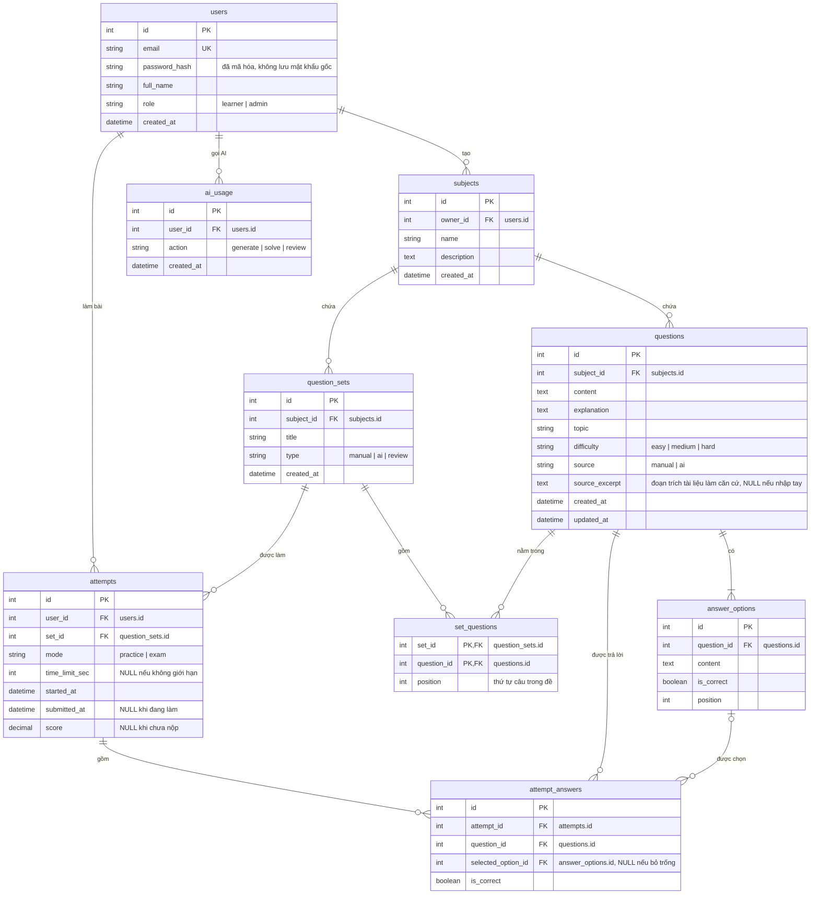

# Thiết kế cơ sở dữ liệu

> Nguồn sự thật cho thiết kế CSDL đến khi nhóm chốt ORM. Mọi thay đổi bảng hoặc cột phải sửa file này qua PR.
> Kiểu dữ liệu đang ghi dạng chung, sẽ đổi theo hệ CSDL nhóm chọn.

## Sơ đồ

Ký hiệu: `||` đúng 1, `|o` 0 hoặc 1, `o{` 0 hoặc nhiều, `|{` 1 hoặc nhiều.

## Ý nghĩa từng bảng (mỗi dòng là gì)

| Bảng | Mỗi dòng là |
|---|---|
| `users` | Một tài khoản |
| `subjects` | Một môn học do một người tạo |
| `questions` | Một câu hỏi trong ngân hàng câu hỏi của môn |
| `answer_options` | Một lựa chọn (A/B/C/D) của một câu hỏi |
| `question_sets` | Một đề |
| `set_questions` | "Câu X nằm trong đề Y ở vị trí Z" |
| `attempts` | Một lần một người làm một đề |
| `attempt_answers` | Một câu đã trả lời trong một lần làm bài |
| `ai_usage` | Một lần gọi AI, dùng để giới hạn lượt theo ngày |

## Quyết định thiết kế

1. **Câu hỏi thuộc môn, không thuộc đề.** Một câu nằm được trong nhiều đề qua bảng trung gian `set_questions`, nên sửa câu một lần là mọi đề cập nhật theo.
2. **Đáp án là bảng riêng**, để `attempt_answers` ghi được chính xác lựa chọn của người dùng.
3. **Lưu từng câu trả lời**, không chỉ lưu điểm, vì thống kê câu sai và đề ôn đều cần dữ liệu này.
4. **Không có bảng thống kê.** Câu hay sai được tính từ `attempt_answers` với `is_correct = false`, nên dữ liệu chỉ nằm một chỗ.
5. **Đề ôn từ câu sai** là một `question_sets` có `type = review`, trỏ lại các câu cũ qua `set_questions`.
6. **Giới hạn lượt AI** bằng cách đếm số dòng `ai_usage` của người dùng trong ngày.

## Ràng buộc cần đảm bảo trong code

- `users.email` là duy nhất.
- Mỗi câu hỏi có ít nhất 2 đáp án và đúng 1 đáp án đúng.
- Một câu không xuất hiện hai lần trong cùng một đề (khóa chính kép của `set_questions`).
- `attempt_answers.question_id` phải thuộc đề của `attempts.set_id` tương ứng.
- `attempt_answers.selected_option_id`, nếu có, phải là đáp án của đúng `question_id` đó.
