# Phác thảo các màn hình chính — EduQuiz

Tài liệu mô tả giao diện dự kiến của hệ thống EduQuiz, giúp các thành viên thống nhất thiết kế trước khi triển khai frontend.

IDEA:
" Màn hình giao diện chính " sau khi người dùng đăng nhập sẽ bao gồm : Danh sách môn ( bao gồm Chi tiết môn ( ngân hàng câu hỏi và danh sách đề )), Tạo đề thủ công ( bao gồm Form câu hỏi, chức năng Dán văn bản ), Tạo đề tự động ( bao gồm Tạo đề ), chọn chế độ làm bài (bao gồm Ôn tập và Thi thử ), còn chức năng " Kết quả, lịch sử xem lại và Tổng hợp câu sai " sẽ là cửa sổ hiện ra sau khi người dùng làm xong đề Ôn Tập hoặc Thi Thử
Chức năng " Quản trị người dùng " và các tiện ích để chỉnh cỡ chữ, phông chữ, màu nền, thêm ảnh đại diện, đổi mật khẩu, … thì mình sẽ để ở phần " Setting " ở góc trên bên phải của " Màn hình giao diện chính " ( Sau khi ấn vào phần tên đăng nhập thì sẽ hiện ra Setting và phần “ Đăng xuất ” ở dưới )
" Danh sách môn " : là 1 folder chứa các " Tên môn " ở trong đó và cho phép tạo thêm “ Môn “ mới
Trong folder " Tên môn " sẽ bao gồm file " Ngân hàng câu hỏi " và folder " Danh sách đề " chứa các file đề con
" Form câu hỏi, dán văn bản " : là cách tạo đề thủ công, nghĩa là web sẽ cung cấp trước cho người dùng 1 form mẫu và người dùng chỉ cần thêm nội dung của " Đề bài ", " Các đáp án ABCD " " Hình ảnh " ( nếu có ), " Đáp án đúng " và trình duyệt sẽ tự tạo cho người dùng 1 file đề
" AI sinh câu hỏi, tạo đề " : là cách tạo đề bằng công cụ, nghĩa là web sẽ dùng mô hình AI, token để sinh ra 1 file đề
" Chọn chế độ làm bài " : là cửa sổ người dùng có thể cho file đề vào trong để làm dữ liệu ôn tập, ứng dụng sẽ giúp chuyển sang bài trắc nghiệm có tính tương tác
" Ôn tập " : ứng dụng sẽ theo dõi thời gian, sau mỗi câu trả lời của người dùng, ứng dụng sẽ check luôn đáp án và trả lại đáp án chính xác kèm theo lời giải thích, sau đó sẽ lưu lại bài trắc nghiệm vào " Lịch sử làm bài " và có thể cho người dùng làm lại nhiều lần
" Thi thử " : ứng dụng sẽ chọn random các câu hỏi ở trong các file câu hỏi đã được cho vào và chia đều kiến thức ở các đề, người dùng có thể đặt giới hạn thời gian, sau đó sẽ lưu lại bài trắc nghiệm vào " Lịch sử làm bài " ( Giống với " Ôn tập " thì "Thi Thử " cũng sẽ là giao diện của bài trắc nghiệm có tính tương tác. Khác của " Ôn tập " so với "Thi Thử " là : Thứ nhất, sau mỗi câu trả lời ứng dụng sẽ không check tính đúng sai, mà đến cuối sau khi kết thúc thì mới đưa điểm và đưa ra lời giải thích. Thứ 2, " Ôn tập " chỉ được chọn 1 file đề, còn " Thi Thử " sẽ có thể chọn nhiều file để tổng hợp )
" Kết quả, xem lại, tổng hợp các câu sai " : sau khi hoàn thành ôn tập, ứng dụng sẽ trả về 1 dạng thống kê bao gồm điểm ( trên thang 10 ), số câu đúng / tổng số câu, trả lại bài kiểm tra theo thứ tự các câu (1,2,3,...) và sẽ hiện nền màu xanh ở phần " Đề bài " của mỗi câu nếu đúng, hiện nền màu đỏ nếu sai. Có nút " Xem lại các câu sai " để tổng hợp lại, kèm theo giải thích và cho phép người dùng luyện lại các câu sai đó
" Lịch sử làm bài " : ứng dụng sẽ lưu lại tên của bài trắc nghiệm theo người dùng đặt ( nếu không thì sẽ chỉ ghi " Đề ôn tập số ..." hoặc " Đề thi thử số ..." ), kèm theo điểm, thời gian làm bài và ngày tháng năm tạo đề đó

## 1. Màn hình chính

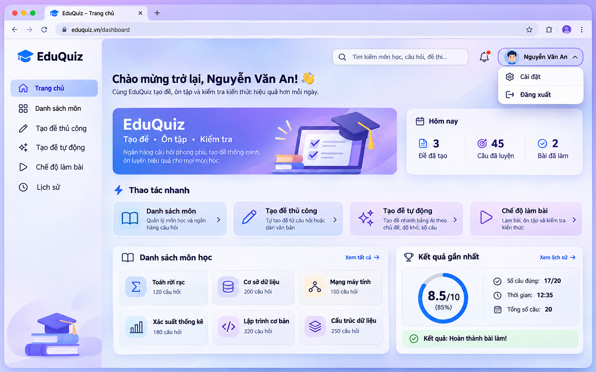

## 2. Danh sách môn học

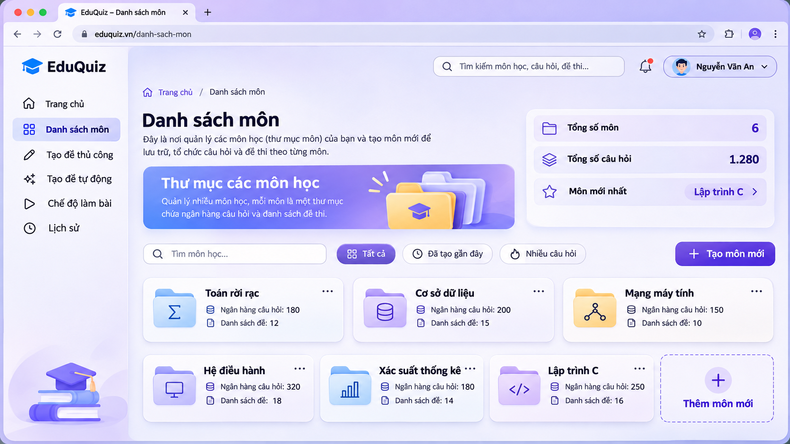

## 3. Chi tiết môn học

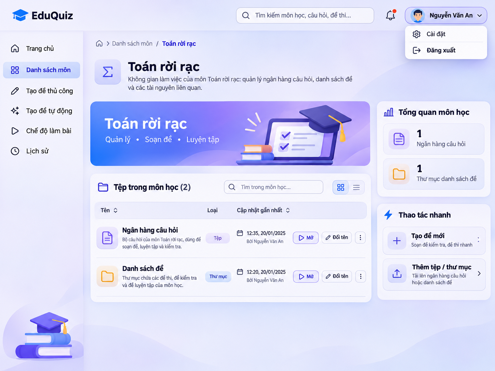

## 4. Danh sách đề

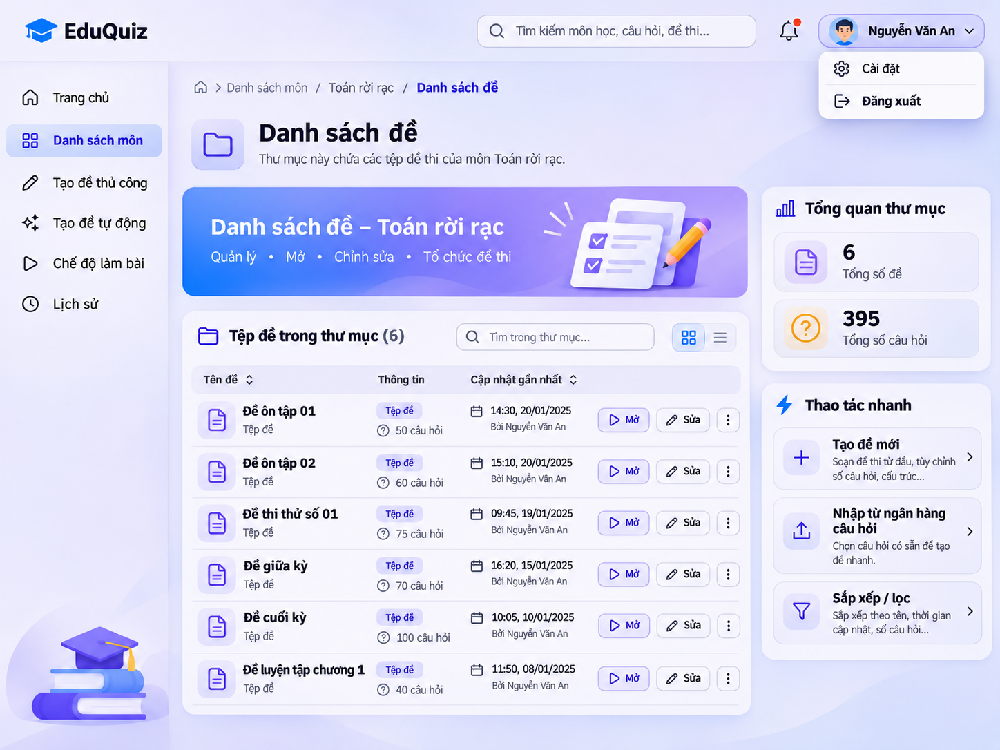

## 5. Tạo đề thủ công

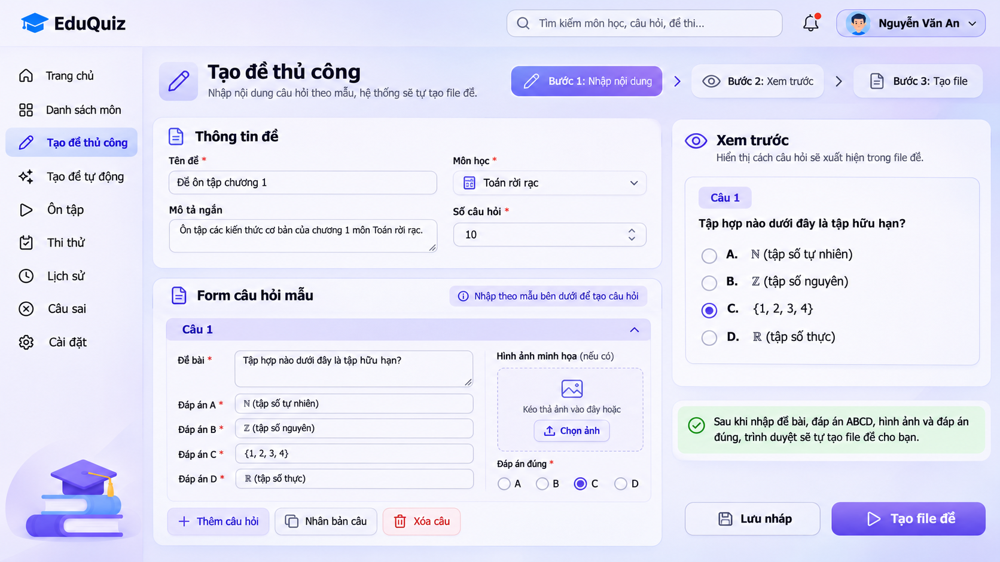

## 6. Tạo đề tự động bằng AI

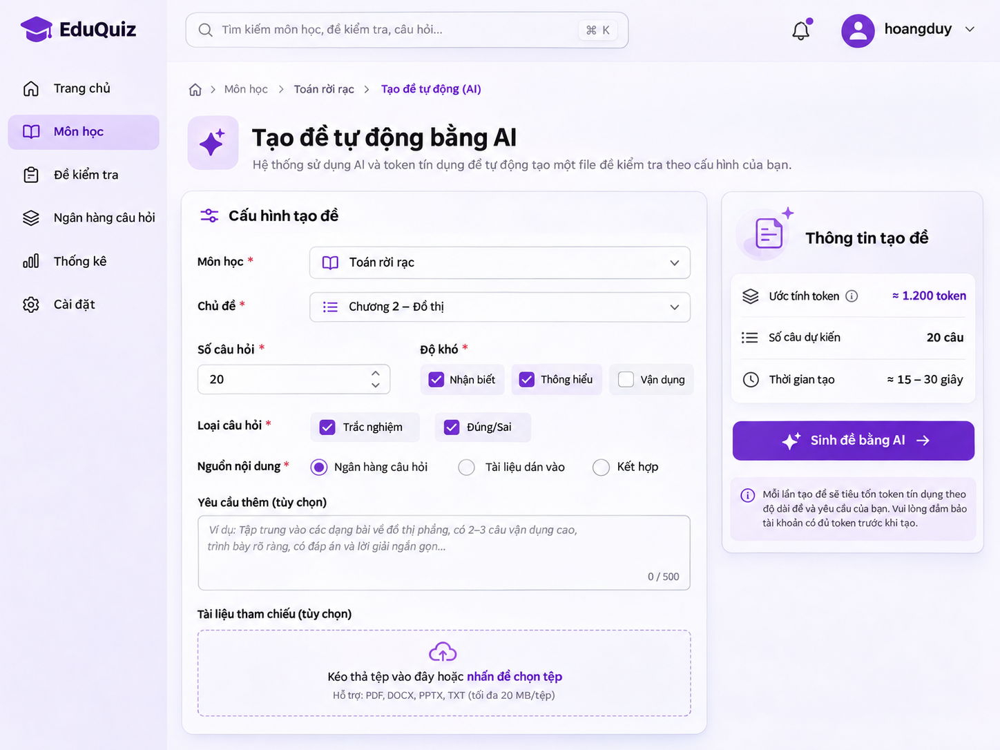

## 7. Chọn chế độ làm bài

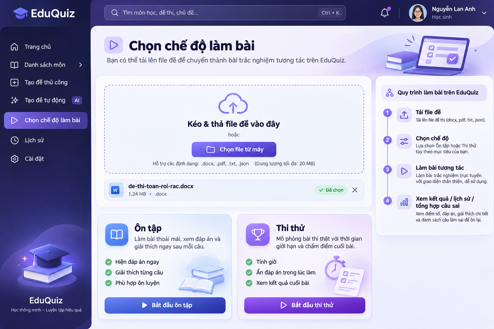

## 8. Chế độ ôn tập

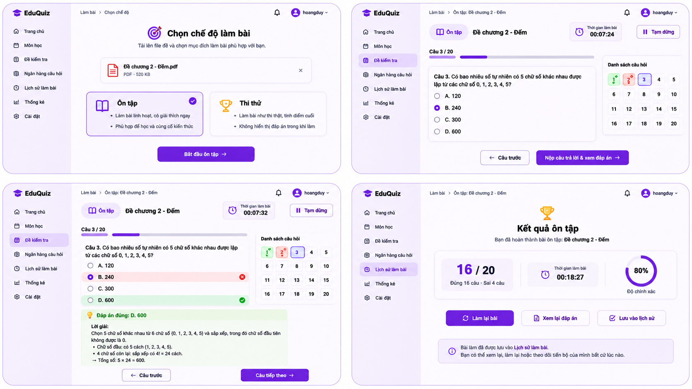

## 9. Chế độ thi thử

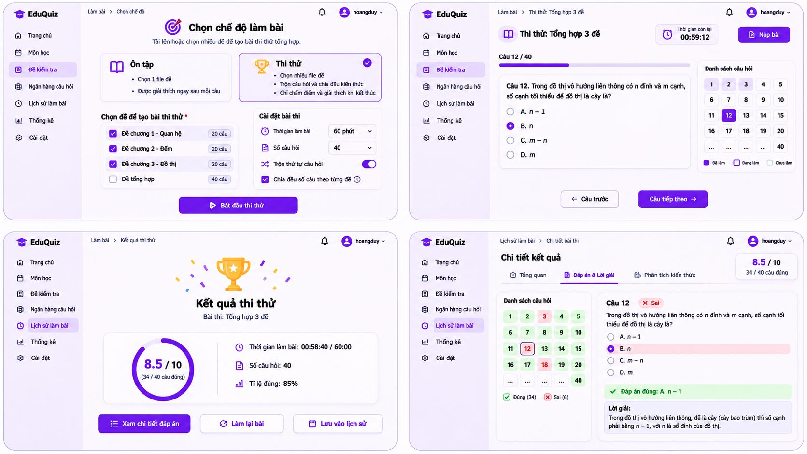

## 10. Lịch sử làm bài

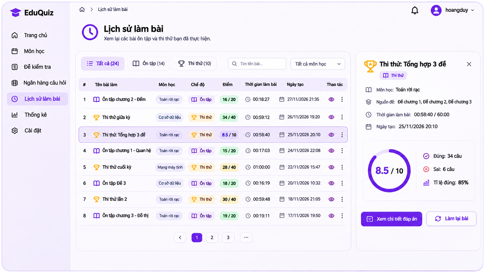

## 11. Cài đặt

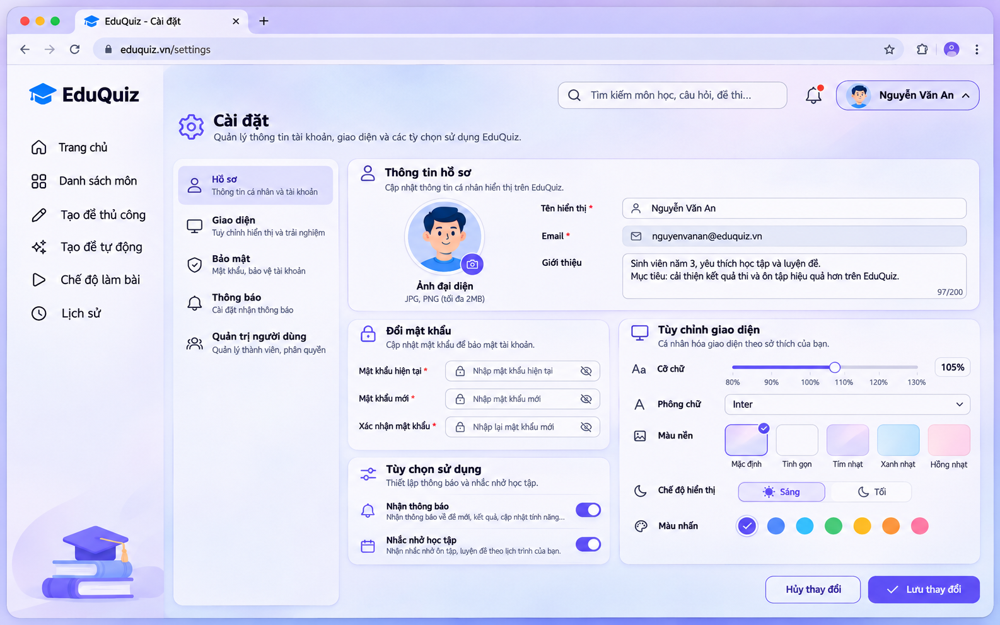

## 12. Quản trị người dùng

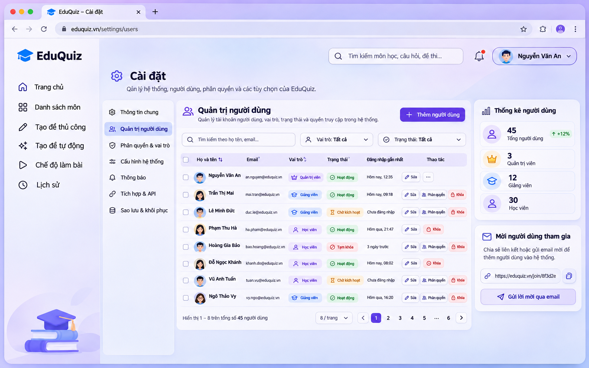